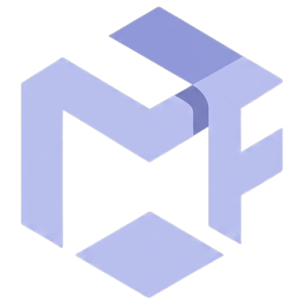

  

# Mila — AI UI/UX Intelligence Toolkit 🚀

> **Mila** is an active UI/UX intelligence system and MCP server for autonomous AI coding agents (Claude Code, Cursor, Windsurf, Antigravity, v0). Inspired by HorizonX's agent-first paradigm, Mila teaches AI coding tools how to build beautiful, production-ready interfaces with mathematical precision and zero "AI slop".

**Mila ships as five installable npm packages:** a curated component registry, an MCP server with 7 agent tools, a CLI, design rules, and an automated code reviewer — plus a live Mobbin-style demo website.

📚 **[Read the Complete Installation Guide](./INSTALL.md)** — Install Mila as a dependency in your project.
📚 **[Read the Complete Integration Guide](./INTEGRATION_GUIDE.md)** — Connect Mila to AI agents, import components, and prompt effectively.

---

## Table of Contents
1. [The 5 Packages](#-the-5-packages)
2. [Quickstart](#-quickstart-30-seconds)
3. [Available Components](#-available-components-14-components)
4. [Available MCP Tools](#-available-mcp-tools-7-agent-tools)
5. [CLI Reference](#-cli-reference)
6. [Connect to AI Agents](#-connect-to-ai-agents)
7. [Use the Registry Programmatically](#-use-the-registry-programmatically)
8. [Demo Website](#-demo-website-mobbin-style-gallery)
9. [Build & Test](#-build--test)
10. [Project Structure](#-project-structure)

---

## 📦 The 5 Packages

| Package | npm | Version | Purpose | Install |
| :--- | :--- | :--- | :--- | :--- |
| **Registry** | `@mila/registry` | 1.1.0 | Curated component + template registry (searchable catalog with copy-paste source) | `bun add @mila/registry` |
| **MCP Server** | `@mila/mcp` | 0.2.0 | MCP server — connects Mila to Cursor, Claude Code, Windsurf, Antigravity | `bun add --dev @mila/mcp` |
| **CLI** | `@mila/cli` | 1.0.0 | CLI — `mila init`, `mila add`, `mila doctor`, `mila search` | `bun add --dev @mila/cli` |
| **Rules** | `@mila/rules` | 0.1.0 | Design intelligence rules (typography, colors, 8pt grid, 3D motion) | `bun add @mila/rules` |
| **Review** | `@mila/review` | 0.1.0 | Heuristic code auditor (magic numbers, contrast, accessibility, mobile) | `bun add @mila/review` |

All packages are **TypeScript** with full type declarations, published as **ESM**, and licensed **MIT**.

---

## 🚀 Quickstart (30 seconds)

\`\`\`bash
# 1. Install the toolkit
bun add @mila/registry
bun add --dev @mila/mcp @mila/cli

# 2. Initialize (creates .cursor/mcp.json + components/ui/)
npx mila init

# 3. Add a component (copies source into your project)
npx mila add tilt-3d-card

# 4. Verify your setup
npx mila doctor

# 5. Search components
npx mila search 3d
\`\`\`

---

## 🎨 Available Components (14 Components)

| Component | Category | Description | Deps |
| :--- | :--- | :--- | :--- |
| \`spotlight-card\` | card | Cursor-tracking radial spotlight border glow effect | react |
| \`before-after-slider\` | interactive | Smooth drag & touch-responsive before/after comparison slider | react |
| \`tilt-3d-card\` | 3d-motion | CSS 3D parallax tilt with concentric depth layers & dynamic glare | react |
| \`particle-wave-3d\` | 3d-motion | Canvas 3D wireframe particle landscape with cursor camera orbit | react |
| \`screen-card\` | card | Mobbin-style screen card with 3D tilt + open-source images | react, next |
| \`image-from-url\` | asset | Open-source image renderer (Lorem Picsum / Unsplash) with SVG fallback | next, react |
| \`bento-grid\` | bento | Asymmetrical grid with simulated agent terminal & live metrics | react |
| \`hero-geometric\` | hero | Geometric wireframe hero with ambient blur & dual CTA | react |
| \`hero-section\` | hero | 3D particle hero with canvas background & dual CTA | react, framer-motion, lucide-react |
| \`floating-navbar\` | nav | Scroll-aware floating pill navbar | react, lucide-react |
| \`navbar\` | nav | Full navigation bar with mobile drawer, category chips, auth actions | react, next, lucide-react |
| \`pricing-section\` | pricing | 3-tier pricing matrix with featured plan spotlight | react, lucide-react |
| \`pricing-matrix\` | pricing | Pricing cards with toggle switch & feature checklist | react |
| \`bento-showcase\` | bento | Asymmetrical bento grid with Framer Motion reveals & terminal tiles | react, framer-motion, lucide-react |

### Available Templates
| Template | Components Used | Description |
| :--- | :--- | :--- |
| \`modern-saas-landing\` | floating-navbar, hero-geometric, bento-grid, pricing-matrix | Complete conversion-oriented SaaS landing page |

---

## 🛠 Available MCP Tools (7 Agent Tools)

| Tool | Input | Output |
| :--- | :--- | :--- |
| \`mila_search\` | \`query\` (string), \`category\` (optional) | Matching components with name, description, category & tags |
| \`mila_get_component\` | \`name\` (component slug) | Full TSX source code, title, description & required deps |
| \`mila_get_rules\` | \`topic\` (typography/colors/layout/spacing/3d-motion/anti-patterns/all) | Design intelligence rules & mathematical principles |
| \`mila_generate_theme\` | \`themeNameOrKeyword\` | Accessible token palette + Tailwind v4 \`@theme\` block |
| \`mila_get_template\` | \`templateName\` (e.g. \`modern-saas-landing\`) | Complete multi-component page layout composition |
| \`mila_review_code\` | \`code\` (JSX/TSX snippet) | Quality score (0-100) with flagged issues & fix suggestions |
| \`mila_auto_fix\` | \`code\` (TSX snippet) | Refactored code with magic numbers replaced, mobile grids fixed, focus rings added |

### Theme Presets
\`mila_generate_theme\` supports: \`electric-indigo\`, \`cyber-emerald\`, \`obsidian-mono\`, \`warm-editorial\`, \`fintech\`, \`crypto\`, \`luxury\`, \`neobrutalism\`.

---

## 🔌 Connect to AI Agents

### Cursor IDE
\`\`\`bash
npx mila init
\`\`\`
Creates \`.cursor/mcp.json\` automatically. Or manually:
\`\`\`json
{
  "mcpServers": {
    "mila": {
      "command": "npx",
      "args": ["-y", "@mila/mcp"]
    }
  }
}
\`\`\`

### Claude Code (Terminal CLI)
\`\`\`bash
claude mcp add mila -- npx -y @mila/mcp
\`\`\`

### Windsurf IDE
Add to \`~/.codeium/windsurf/mcp_config.json\` (same config as Cursor above).

### Antigravity CLI / IDE
Add to \`~/.gemini/antigravity-cli/mcp.json\` (same config as Cursor above).

> **Or run locally from source:** \`bun run packages/mcp-server/src/index.ts\`

---

## 💻 CLI Reference

### \`mila init\`
Sets up Mila in your project:
- Installs \`@mila/mcp\` as a devDependency
- Creates \`.cursor/mcp.json\` with the MCP server config
- Creates \`components/ui/\` directory

### \`mila add <component-name>\`
Copies a Mila component's source code directly into your \`components/ui/\` directory (shadcn-style). Automatically reports required peer dependencies.

\`\`\`bash
npx mila add tilt-3d-card   # → components/ui/Tilt3DCard.tsx
npx mila add screen-card    # → components/ui/ScreenCard.tsx
npx mila add particle-wave-3d # → components/ui/ParticleWave3D.tsx
npx mila add navbar         # → components/ui/Navbar.tsx
\`\`\`

### \`mila search <query>\`
Search the component catalog by keyword or list all available components.

\`\`\`bash
npx mila search 3d          # → tilt-3d-card, particle-wave-3d, hero-section, bento-showcase
npx mila search hero        # → hero-geometric, hero-section
npx mila search             # → lists all 14 components
\`\`\`

### \`mila doctor\`
Verifies your setup — checks \="@mila/registry\` is installed, MCP config exists, and lists components in \`components/ui/\`.

---

## 🧩 Use the Registry Programmatically

\`\`\`typescript
import { registry, searchComponents, getComponentDetails } from "@mila/registry";

// List all components
console.log(registry.components.map((c) => c.name));

// Search by keyword or category
const results = searchComponents("3d", "3d-motion");
// → 2 components: tilt-3d-card, particle-wave-3d

// Get full source code for copy-paste
const { entry, sourceCode } = getComponentDetails("tilt-3d-card");
console.log(entry.title);           // "3D Perspective Tilt Card with Dynamic Glare"
console.log(entry.dependencies);    // ["react"]
console.log(sourceCode);            // Full TSX file contents
\`\`\`

---

## 🌐 Demo Website (Mobbin-Style Gallery)

The \`apps/web/\` directory contains a live Next.js 15 showcase that demonstrates every Mila component and design rule:

- **3 pages**: Home, Browse (search + category filter), Screen Detail
- **3D animations**: Canvas particle landscape, CSS 3D tilt cards, Framer Motion reveals
- **Images from open-source URLs**: Renders from Lorem Picsum / Unsplash with SVG fallback (no API keys)
- **Free SVG icons**: `lucide-react` throughout
- **Mila rules applied**: neutral-950 dark canvas, 8pt spacing grid, WCAG AA contrast, focus rings

\`\`\`bash
cd apps/web
bun install
bun dev
# → http://localhost:3000
\`\`\`

---

## 🏗 Build & Test

\`\`\`bash
# Build all packages (registry, rules, review, mcp, cli, web)
bun run build

# Run tests
bun test

# Test the MCP server directly
bun packages/mcp-server/src/index.ts

# Test CLI commands
bun packages/cli/src/index.ts search 3d
\`\`\`

**Test suite (6 tests, all passing):**
\`\`\`
✓ should search for 3D motion components by keyword
✓ should retrieve full 3D tilt card and 3D particle canvas source code
✓ should fetch 3D motion design rules
✓ should generate dynamic color themes and CSS variables
✓ should auto-fix bad AI code into clean production code
✓ should audit code and award passing scores to clean code
\`\`\`

---

## 📂 Project Structure

\`\`\`
Mila/
├── package.json                  # Workspace root (bun workspaces)
├── .cursorrules                  # Drop-in design rules for any project
├── INSTALL.md                    # Complete installation guide
├── INTEGRATION_GUIDE.md          # End-to-end integration handbook
│
├── packages/
│   ├── registry/                 → @mila/registry (component catalog + source files)
│   │   ├── src/components/       # 14 production-ready .tsx components
│   │   ├── src/templates/        # Page layout compositions
│   │   ├── src/registry.json     # Structured component manifest
│   │   └── src/lib/data.ts       # Registry query helpers
│   │
│   ├── rules/                    → @mila/rules (design intelligence)
│   │   ├── src/*.md              # Typography, colors, layout, 3D motion, anti-patterns
│   │   └── src/theme-generator.ts  # Adaptive theme generator
│   │
│   ├── review/                   → @mila/review (heuristic code auditor)
│   │   └── src/index.ts          # Scoring engine (0-100 quality score)
│   │
│   ├── mcp-server/               → @mila/mcp (MCP server for AI agents)
│   │   ├── src/index.ts          # 7-tool MCP server (stdio transport)
│   │   └── src/tools/            # Tool handlers
│   │
│   └── cli/                      → @mila/cli (developer CLI)
│       └── src/index.ts          # init / add / doctor / search
│
├── apps/
│   └── web/                      → @mila/web (demo website — Mobbin-style gallery)
│       ├── app/                  # Next.js 15 app router (3 pages)
│       ├── components/           # Hero, BentoShowcase, FeaturedGrid, etc.
│       └── lib/data.ts           # Screen data

tests/
└── mcp-server.test.ts            # Integration test suite (6 tests)
\`\`\`

---

## 🎯 What Mila Solves

Standard AI coding tools generate code that works logically but fails aesthetically:

- **"AI Slop"**: Neon purple-to-pink gradient buttons and low-contrast ghost text
- **Rigid Layouts**: Arbitrary magic pixel widths (\`w-[387px]\`) that break on mobile
- **Missing Interactions**: Static cards with zero focus rings, hover lifts, or press feedback

**Mila acts as your AI agent's dedicated design director:**
1. It provides a **searchable registry** of high-craft components
2. It injects **mathematical design rules** (8pt rhythm, WCAG AA contrast, concentric radiuses)
3. It performs **instant heuristic audits** (\`mila_review_code\`) before you commit
4. It can **auto-repair** anti-patterns (\`mila_auto_fix\`)

---

*Mila is authored by Missari Ahil and released under the MIT License. Inspired by HorizonX's agent-first design paradigm and the shadcn/ui copy-paste philosophy.*
